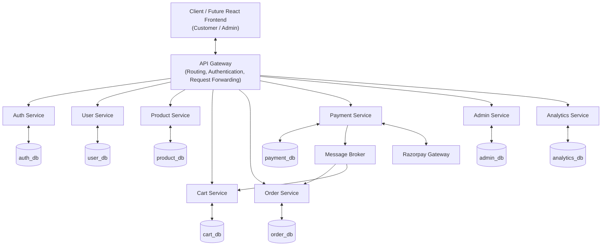
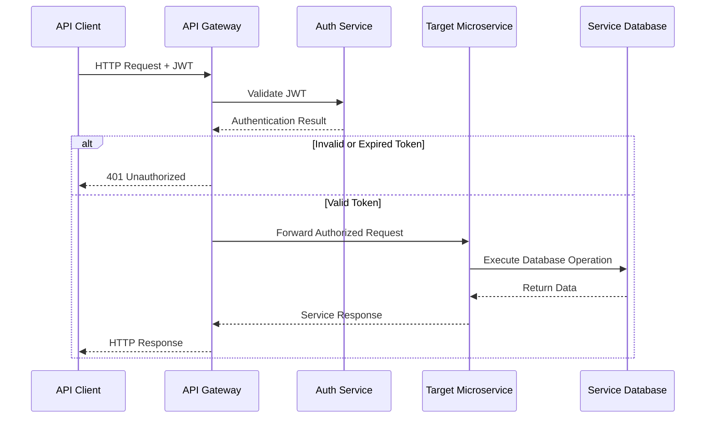
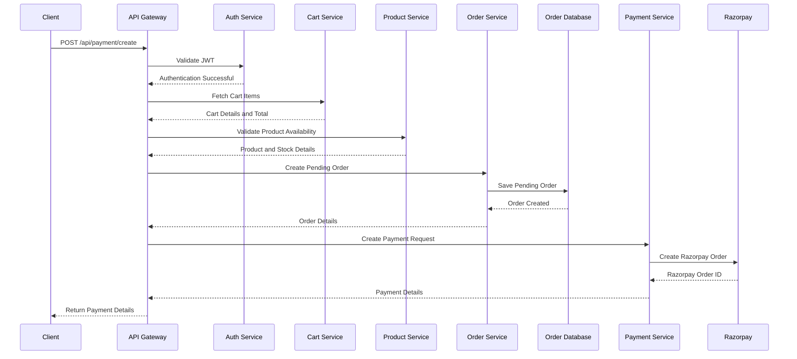
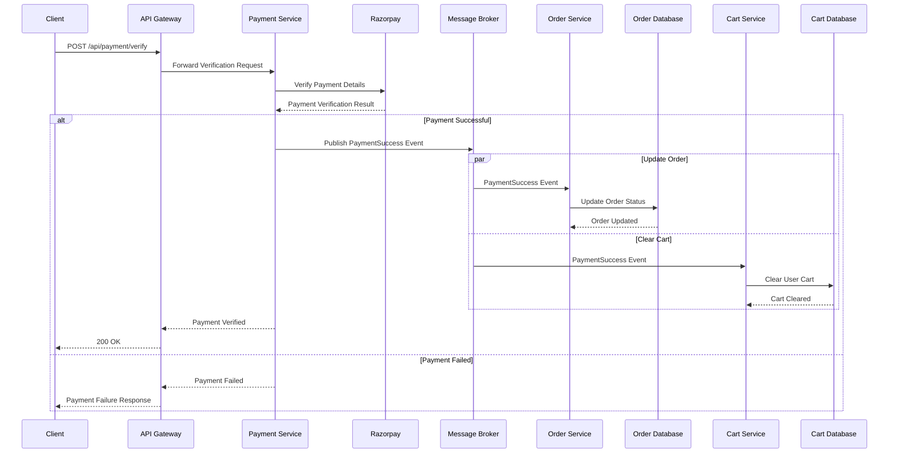
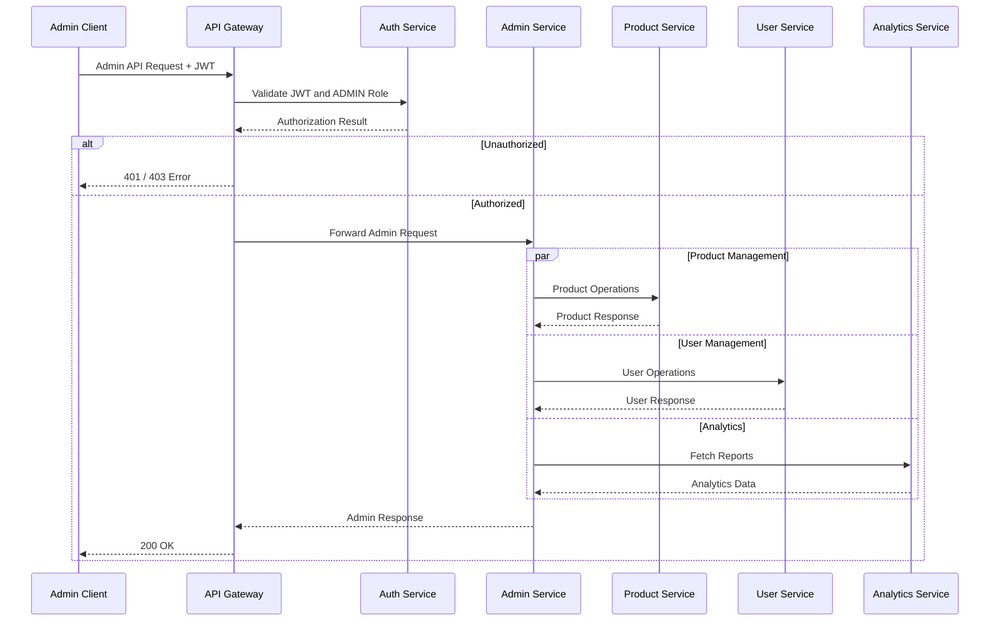
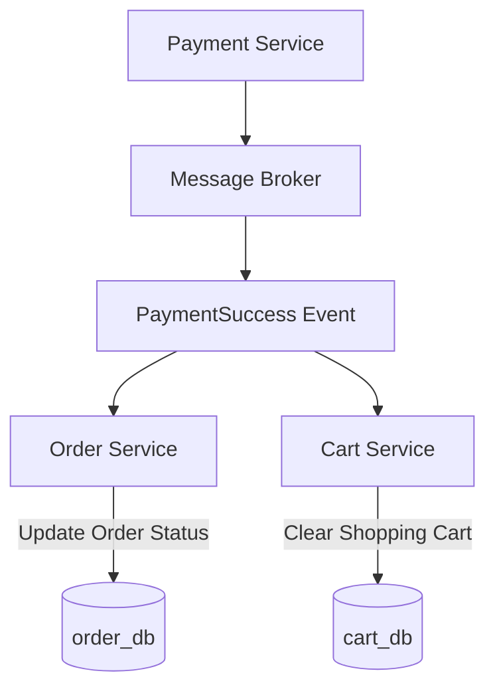

# 🛒 Cartify | Microservices E-Commerce Backend

**Cartify** is a scalable, distributed e-commerce backend built using **Java, Spring Boot, Spring Cloud, and MySQL**, following a Microservices Architecture.

The application separates core e-commerce functionalities into independent microservices, including Authentication, User Management, Product Catalog, Shopping Cart, Order Management, Razorpay Payment Integration, Administration, and Analytics.

Each microservice manages its own database, ensuring service independence, loose coupling, and better scalability.

> **📌 Project Status:** Backend Microservices Architecture and REST APIs. The React.js Customer Storefront and Admin Dashboard are planned for future development. All backend APIs can currently be tested using Postman, cURL, or Swagger.

---

## 🛠️ Tech Stack

| Category | Technologies |
|---|---|
| Programming Language | Java |
| Backend Framework | Spring Boot |
| Microservices Framework | Spring Cloud |
| API Gateway | Spring Cloud Gateway |
| Service Communication | OpenFeign |
| Service Discovery | Spring Cloud Discovery |
| Security | Spring Security, JWT |
| Authentication | HTTP-Only Cookies |
| Authorization | Role-Based Access Control (USER, ADMIN) |
| Database | MySQL |
| ORM | Spring Data JPA, Hibernate |
| Payment Gateway | Razorpay API |
| Inter-Service Communication | REST APIs, Message Broker |
| Frontend (Planned) | React.js |
| API Testing | Postman, Swagger |

---

## 🏗️ System Architecture

Cartify follows the **API Gateway Pattern**, **Database-per-Service Pattern**, and **Event-Driven Communication Pattern**.

All incoming client requests are routed through the API Gateway. For protected endpoints, the Gateway validates the JWT through the Auth Service before forwarding requests to the appropriate microservice.

Each microservice owns its respective database and communicates with other services through REST APIs or asynchronous events.

### Architecture Diagram



### Microservices Overview

| Microservice | Responsibilities | Database |
|---|---|---|
| **API Gateway** | Central entry point, request routing, authentication checks, and request forwarding. | None |
| **Auth Service** | User login, JWT generation and validation, token management, and logout. | `auth_db` |
| **User Service** | User registration, password encryption, and profile management. | `user_db` |
| **Product Service** | Product catalog, categories, stock management, and product images. | `product_db` |
| **Cart Service** | Shopping cart management, item operations, and total price calculation. | `cart_db` |
| **Order Service** | Pending order creation, order confirmation, and order history. | `order_db` |
| **Payment Service** | Razorpay integration, payment order generation, signature verification, and payment events. | `payment_db` |
| **Admin Service** | Administrative operations involving products, users, and reporting. | `admin_db` |
| **Analytics Service** | Daily, monthly, and yearly sales and order reports. | `analytics_db` |

---

## 🔐 Authentication & Authorization Flow

All protected API requests pass through the API Gateway, which communicates with the Auth Service to validate the client's JWT.

The Auth Service verifies the token and returns the authentication result. The Gateway then forwards authorized requests to the appropriate downstream microservice.

**Authentication Flow**



> **Note:** Public endpoints such as registration and login do not require an existing JWT. Admin endpoints additionally require the ADMIN role.

---

# 🔄 Request & Response Lifecycles

The following lifecycles describe how client requests travel through the API Gateway and microservices, how databases are accessed, and how responses are returned to the client.

The React Frontend is planned. Until then, these API endpoints can be tested using Postman, cURL, or Swagger.

## Lifecycle 1: User Registration

**API:** `POST /api/users/register`

```text
Client
  |
  | POST /api/users/register
  | User Registration Details
  v
API Gateway
  |
  | Route Registration Request
  v
User Service
  |
  | Validate User Details
  | Encrypt Password
  | Save User Information
  v
User Database (user_db)
  |
  | Return Saved User Details
  v
User Service
  |
  | Prepare Registration Response
  v
API Gateway
  |
  v
Client

Response: 201 CREATED

{
  "message": "User registered successfully"
}
```

## Lifecycle 2: User Login

**API:** `POST /api/auth/login`

```text
Client
  |
  | POST /api/auth/login
  | Username and Password
  v
API Gateway
  |
  | Route Login Request
  v
Auth Service
  |
  | Validate Login Request
  | Communicate with User Service
  v
User Service
  |
  | Fetch User Information
  v
User Database (user_db)
  |
  | Return User Details
  v
Auth Service
  |
  | Verify Password
  | Generate JWT
  | Manage Authentication Token
  v
Auth Database (auth_db)
  |
  | Token Management
  v
Auth Service
  |
  | Return Authentication Response
  v
API Gateway
  |
  v
Client

Response: 200 OK

Set-Cookie: authToken; HttpOnly

{
  "message": "Login successful",
  "username": "naveen",
  "role": "USER"
}
```

## Lifecycle 3: Get Products

**API:** `GET /api/products`

```text
Client
  |
  | GET /api/products
  | Cookie: authToken (if protected)
  v
API Gateway
  |
  | Validate JWT (if protected)
  v
Auth Service
  |
  | Return Authentication Result
  v
API Gateway
  |
  | Forward Request
  v
Product Service
  |
  | Fetch Products
  | Fetch Categories
  | Fetch Product Images
  v
Product Database (product_db)
  |
  | Return Product Information
  v
Product Service
  |
  | Prepare Product Response
  v
API Gateway
  |
  v
Client

Response: 200 OK

{
  "products": [
    {
      "product_id": 101,
      "name": "Laptop",
      "price": 50000,
      "stock": 10,
      "images": []
    }
  ]
}
```

## Lifecycle 4: Add Product to Cart

**API:** `POST /api/cart/add`

**Request Body:**

```json
{
  "productId": 101,
  "quantity": 2
}
```

**Request Lifecycle:**

```text
Client
  |
  | POST /api/cart/add
  | Product ID and Quantity
  v
API Gateway
  |
  | Validate JWT
  v
Auth Service
  |
  | Return Authentication Result
  v
API Gateway
  |
  | Forward Request
  v
Cart Service
  |
  | Validate Product Information
  v
Product Service
  |
  | Fetch Product Details
  v
Product Database (product_db)
  |
  | Return Product Details
  v
Cart Service
  |
  | Add Product to Cart
  | Calculate Item Total
  v
Cart Database (cart_db)
  |
  | Save Cart Item
  v
Cart Service
  |
  v
API Gateway
  |
  v
Client

Response: 201 CREATED

{
  "message": "Product added to cart"
}
```

## Lifecycle 5: Get Cart Items

**API:** `GET /api/cart/items`

```text
Client
  |
  | GET /api/cart/items
  | Cookie: authToken
  v
API Gateway
  |
  | Validate JWT
  v
Auth Service
  |
  | Return Authentication Result
  v
API Gateway
  |
  v
Cart Service
  |
  | Fetch User's Cart
  v
Cart Database (cart_db)
  |
  | Return Cart Items
  v
Cart Service
  |
  | Request Product Details
  v
Product Service
  |
  | Fetch Product Information
  v
Product Database (product_db)
  |
  | Return Product Details
  v
Cart Service
  |
  | Combine Cart and Product Information
  | Calculate Overall Total
  v
API Gateway
  |
  v
Client

Response: 200 OK

{
  "cart": {
    "products": [],
    "overall_total_price": 100000
  }
}
```

## Lifecycle 6: Checkout & Create Payment Order

**API:** `POST /api/payment/create`



**Response: 200 OK**

```json
{
  "razorpayOrderId": "order_123",
  "amount": 100000,
  "currency": "INR"
}
```

## Lifecycle 7: Payment Verification

**API:** `POST /api/payment/verify`

**Request Body:**

```json
{
  "razorpayOrderId": "order_123",
  "razorpayPaymentId": "pay_123",
  "razorpaySignature": "signature_value"
}
```

**Request & Response Lifecycle:**



**Response: 200 OK**

```json
{
  "message": "Payment verified successfully"
}
```

## Lifecycle 8: Get Order History

**API:** `GET /api/orders`

```text
Client
  |
  | GET /api/orders
  | Cookie: authToken
  v
API Gateway
  |
  | Validate JWT
  v
Auth Service
  |
  | Return Authentication Result
  v
API Gateway
  |
  v
Order Service
  |
  | Fetch User's Orders
  v
Order Database (order_db)
  |
  | Return Order Information
  v
Order Service
  |
  | Request Product Details
  v
Product Service
  |
  | Fetch Product Information
  v
Product Database (product_db)
  |
  | Return Product Details
  v
Order Service
  |
  | Prepare Order History Response
  v
API Gateway
  |
  v
Client

Response: 200 OK

{
  "orders": [
    {
      "order_id": "order_123",
      "status": "SUCCESS",
      "products": []
    }
  ]
}
```

## Lifecycle 9: Admin Operations

**API:** Admin-specific API endpoints.



**Response: 200 OK**

```json
{
  "message": "Admin operation successful"
}
```

---

## 📡 Inter-Service Communication

Cartify uses two communication approaches:

| Communication Type | Purpose | Example |
|---|---|---|
| Synchronous Communication | Immediate request and response between services. | Cart Service → Product Service |
| Asynchronous Communication | Event-based communication without waiting for downstream processing. | Payment Service → Order Service and Cart Service |

### Event-Driven Payment Flow



---

## 📁 Microservices Database Architecture

Cartify implements the **Database-per-Service Pattern**, where each microservice maintains ownership of its own database.

| Database | Owned By |
|---|---|
| `auth_db` | Auth Service |
| `user_db` | User Service |
| `product_db` | Product Service |
| `cart_db` | Cart Service |
| `order_db` | Order Service |
| `payment_db` | Payment Service |
| `admin_db` | Admin Service |
| `analytics_db` | Analytics Service |

**Database Design Principles:**
- Each service owns and manages its database.
- Services access their own databases directly.
- Cross-service data is retrieved through APIs or asynchronous events.
- Direct cross-service database access is avoided.
- Data synchronization is handled through service communication and events.

---

## 🎯 Key Microservices Architecture Concepts Implemented

- **API Gateway Pattern:** Centralized entry point for client requests.
- **Database-per-Service Pattern:** Independent databases for individual microservices.
- **Service Discovery:** Service registration and discovery through Spring Cloud.
- **Inter-Service Communication:** Communication using Spring Cloud OpenFeign and REST APIs.
- **Event-Driven Architecture:** Asynchronous communication for payment-related order and cart updates.
- **JWT Authentication:** Token-based authentication using HTTP-Only Cookies.
- **Role-Based Access Control:** Separate USER and ADMIN authorization.
- **Loose Coupling:** Independent business responsibilities across microservices.
- **Separation of Concerns:** Each microservice manages a specific business domain.

---

## 🚀 Future Enhancements

- React.js Customer Storefront.
- React.js Admin Dashboard.
- Docker containerization for all microservices.
- Docker Compose for local multi-service deployment.
- AWS EC2 deployment.
- CI/CD automation using GitHub Actions.
- Centralized logging and monitoring.
- Distributed tracing.
- Circuit Breaker and Fault Tolerance.
- API documentation using Swagger/OpenAPI.

---

## 👨‍💻 Author

**Cartify | Microservices E-Commerce Backend**

Built with Java, Spring Boot, Spring Cloud, and MySQL.
