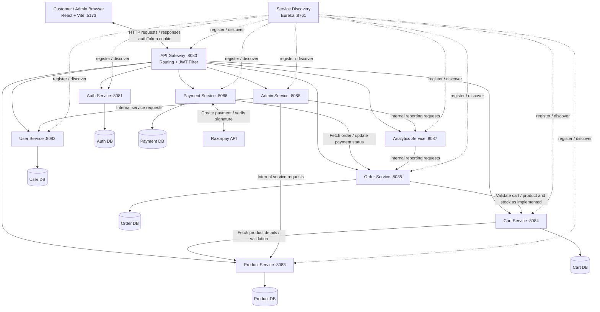
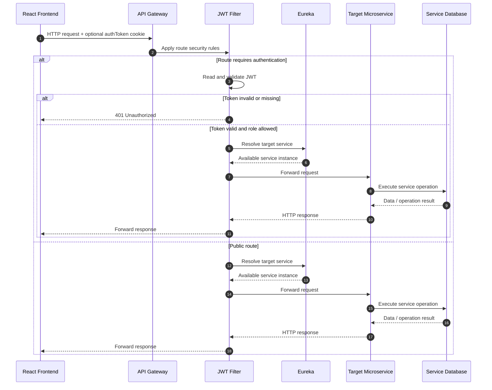
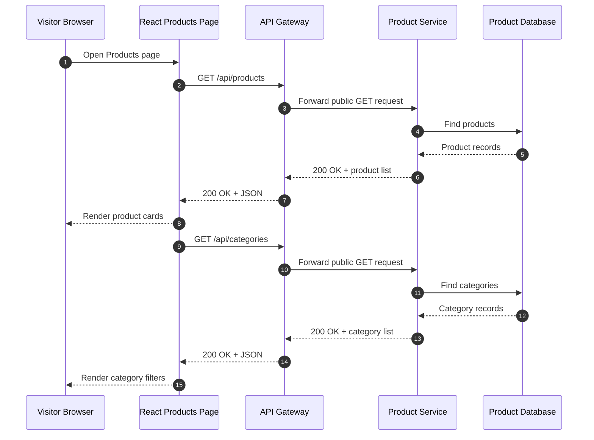
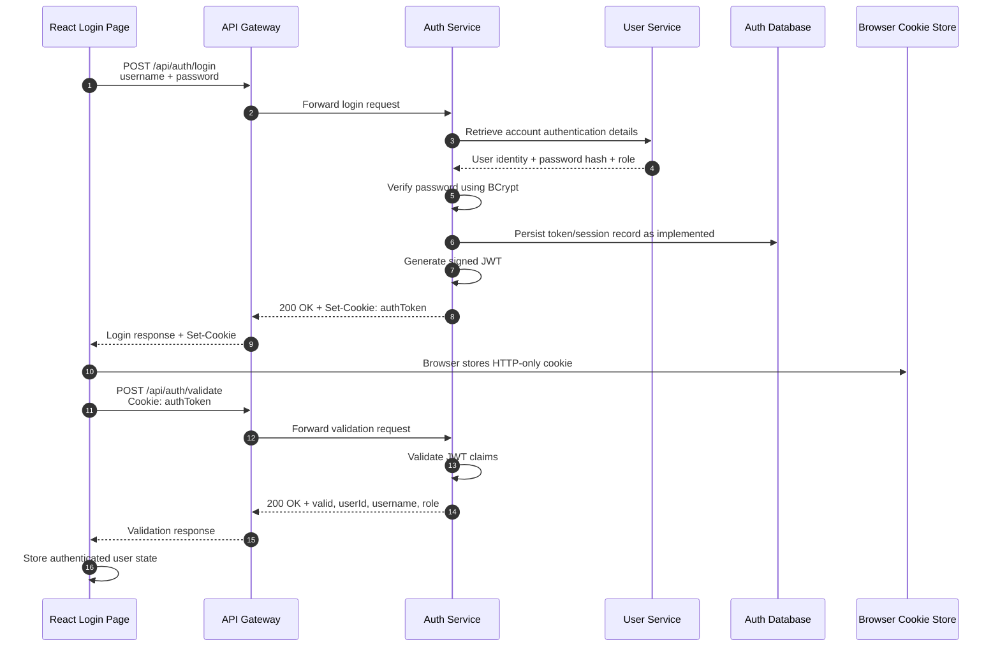
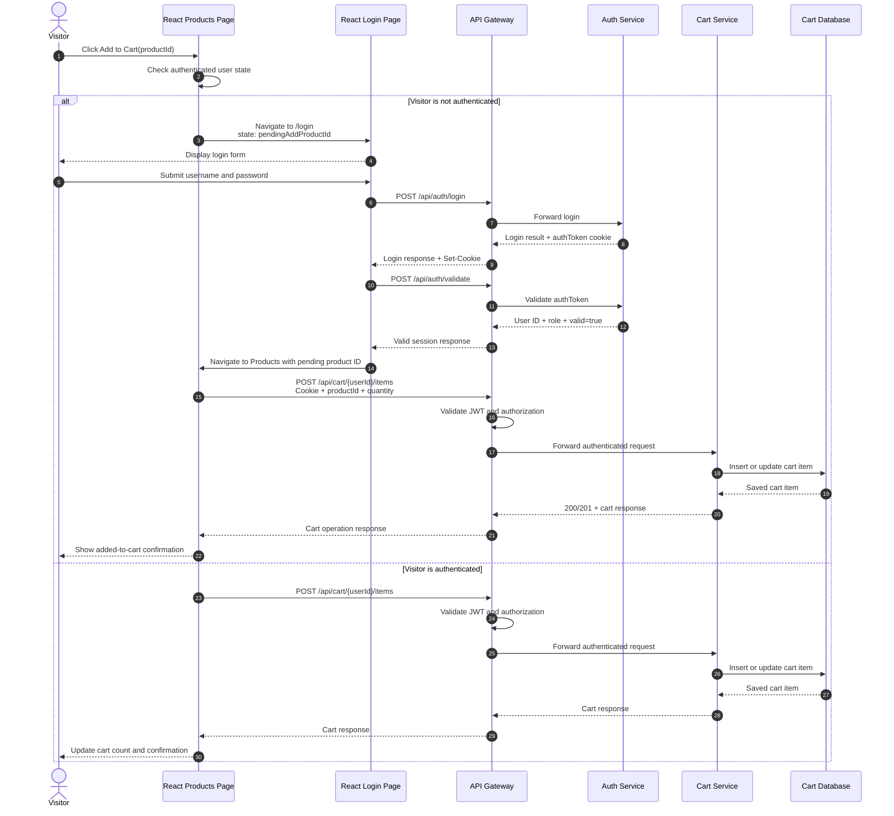
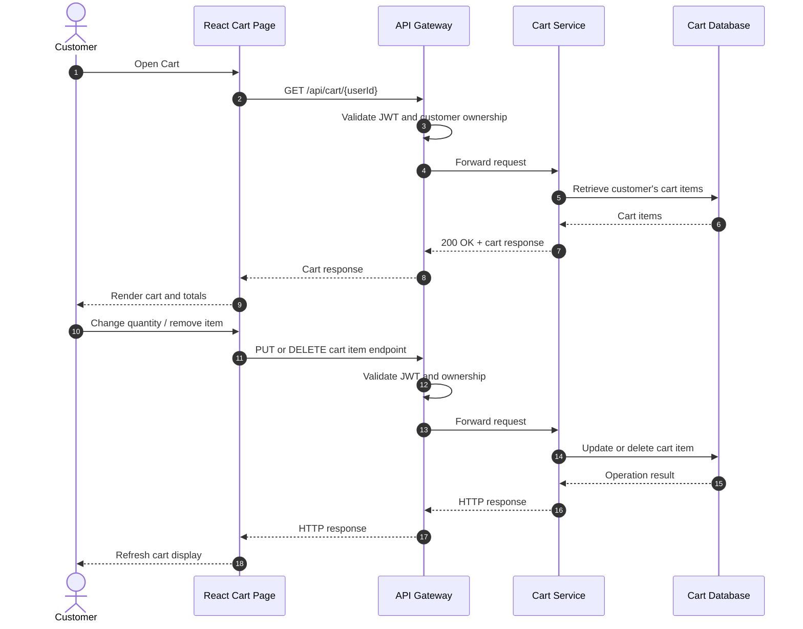
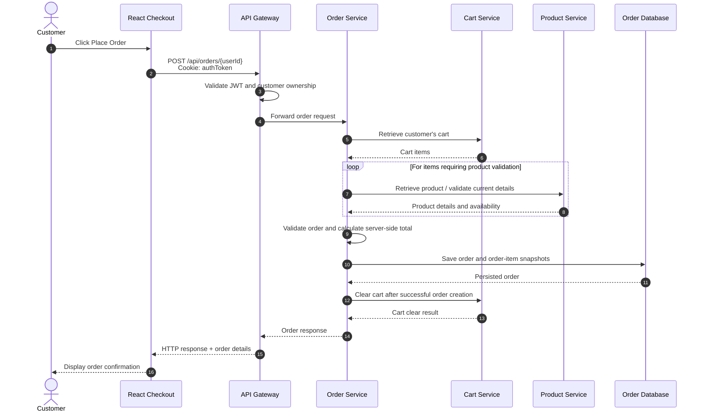
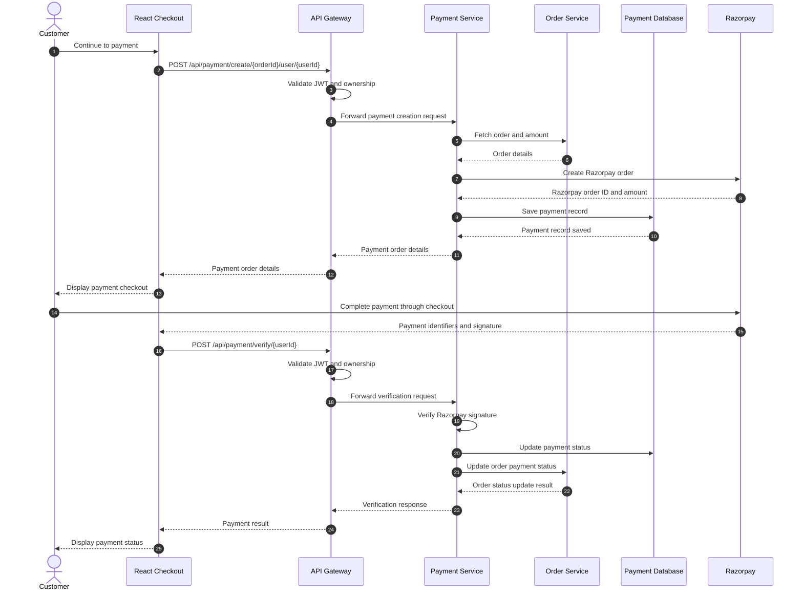
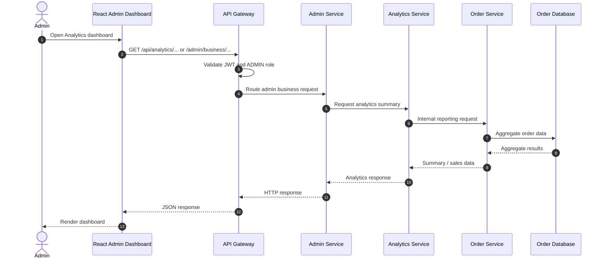

# Cartify | Microservices E-Commerce Application

Cartify is a full-stack e-commerce application built with **React** and **Java Spring Boot microservices**. Customers can browse the product catalogue publicly, authenticate when they want to use customer features, manage a shopping cart, place orders, and complete payments. Administrative and analytics capabilities are provided through separate services.

This README documents the application architecture, setup, API responsibilities, and the end-to-end **request and response lifecycle** between the browser, API Gateway, microservices, databases, and external payment provider.

---

## Contents

1. [Features](#1-features)
2. [Technology Stack](#2-technology-stack)
3. [Microservices and Ports](#3-microservices-and-ports)
4. [Architecture Diagram](#4-architecture-diagram)
5. [Request and Response Lifecycle](#5-request-and-response-lifecycle)
   - [General API request lifecycle](#51-general-api-request-lifecycle)
   - [Public product browsing](#52-public-product-browsing)
   - [Login and session validation](#53-login-and-session-validation)
   - [Add to Cart with login redirect](#54-add-to-cart-with-login-redirect)
   - [Cart retrieval and update](#55-cart-retrieval-and-update)
   - [Order placement](#56-order-placement)
   - [Payment creation and verification](#57-payment-creation-and-verification)
   - [Admin and analytics requests](#58-admin-and-analytics-requests)
6. [API Endpoint Reference](#6-api-endpoint-reference)
7. [Database Ownership](#7-database-ownership)
8. [Project Structure](#8-project-structure)
9. [Prerequisites](#9-prerequisites)
10. [Environment Configuration](#10-environment-configuration)
11. [Run with Docker Compose](#11-run-with-docker-compose)
12. [Run Services Individually](#12-run-services-individually)
13. [Frontend Setup](#13-frontend-setup)
14. [Authorization Rules](#14-authorization-rules)
15. [Testing Checklist](#15-testing-checklist)
16. [Troubleshooting](#16-troubleshooting)
17. [Security Considerations](#17-security-considerations)
18. [Future Improvements](#18-future-improvements)

---

## 1. Features

### Customer features

- Public access to the product catalogue and category listing.
- Product search and category filtering in the frontend.
- Customer registration, login, session validation, and logout.
- JWT authentication stored in an HTTP-only `authToken` cookie.
- Redirect to Login when a signed-out visitor selects **Add to Cart**.
- Preserve the selected product while the visitor signs in, then continue the pending Add to Cart action.
- Add products to cart, view cart, update item quantities, remove items, and clear cart.
- Place orders and view customer order history.
- Create and verify payments through the Payment Service and Razorpay integration.

### Admin and analytics features

- Admin operations for user and product management.
- Admin business summary endpoints.
- Daily, monthly, yearly, overall, and daily-sales analytics.
- Analytics Service retrieves order reporting data from Order Service through internal service communication.

### Platform features

- Microservices architecture with separate service responsibilities.
- Service registration and discovery using Netflix Eureka.
- API routing and centralized gateway authentication using Spring Cloud Gateway.
- Separate database ownership for data-owning services.
- Dockerfiles for service containerization.
- Internal service-to-service communication using HTTP / OpenFeign.

---

## 2. Technology Stack

| Layer | Technology |
|---|---|
| Backend language | Java 17 |
| Backend framework | Spring Boot |
| Microservices framework | Spring Cloud |
| Service discovery | Netflix Eureka |
| API Gateway | Spring Cloud Gateway |
| Inter-service communication | OpenFeign / HTTP |
| Persistence | Spring Data JPA, Hibernate |
| Database | MySQL |
| Frontend | React, JavaScript |
| Frontend build tool | Vite |
| Authentication | JWT, HTTP-only cookie |
| Password hashing | BCrypt |
| Payment integration | Razorpay |
| Build tools | Maven, npm |
| Containerization | Docker, Docker Compose |

Check each service's `pom.xml` and the frontend `package.json` for the exact dependency versions in the checked-out source.

---

## 3. Microservices and Ports

| Service | Default port | Responsibility |
|---|---:|---|
| API Gateway | `8080` | Public API entry point, routing, authentication and authorization filters |
| Service Discovery | `8761` | Eureka registry for service registration and lookup |
| Auth Service | `8081` | Login, JWT generation, token validation, logout |
| User Service | `8082` | Customer registration and user data |
| Product Service | `8083` | Products, categories, and product images |
| Cart Service | `8084` | Customer shopping cart |
| Order Service | `8085` | Order creation, retrieval, cancellation, and internal analytics data |
| Payment Service | `8086` | Payment order creation and payment verification |
| Analytics Service | `8087` | Sales and business analytics |
| Admin Service | `8088` | Admin operations and orchestration |
| React frontend | `5173` | Browser application in Vite development mode |

The browser should communicate with backend services through the API Gateway. Do not configure the React application to call internal service ports directly.

---

## 4. Architecture Diagram



**Architecture principle:** Each data-owning service owns its database. A service should obtain another service's data through that service's API, not by reading its database directly.

---

# 5. Request and Response Lifecycle

## 5.1 General API request lifecycle

Every browser-facing API request is sent to the API Gateway. The Gateway evaluates the route, applies the configured authentication and authorization rules, discovers the destination service, and forwards the request.



### Request path

1. React builds an HTTP request to the Gateway URL, normally `http://localhost:8080`.
2. For authenticated requests, the browser sends the `authToken` cookie when cookie and CORS settings permit it.
3. The Gateway matches the request path to a configured route.
4. The Gateway security filter checks whether the route is public or protected.
5. For protected routes, the JWT is validated and the user's role and resource ownership rules are checked as configured.
6. The Gateway resolves the target service through Eureka / load balancing.
7. The target service validates the request, executes business logic, and accesses only its own database.
8. The service returns an HTTP status and response body.
9. The Gateway forwards the response to React.
10. React updates the UI based on the response.

### Response path

```text
Service Database
      |
      | query result / commit result
      v
Target Microservice
      |
      | HTTP status + JSON response
      v
API Gateway
      |
      | forwarded HTTP response
      v
React Frontend
      |
      | update page / show success or error
      v
Customer Browser
```

Typical HTTP response meanings:

| Status | Meaning |
|---|---|
| `200 OK` | Request completed successfully |
| `201 Created` | Resource created successfully |
| `204 No Content` | Operation completed without a response body |
| `400 Bad Request` | Invalid request data |
| `401 Unauthorized` | Authentication is missing or invalid |
| `403 Forbidden` | Authenticated user is not permitted to perform the operation |
| `404 Not Found` | Requested resource was not found |
| `500 Internal Server Error` | Unexpected service error |
| `503 Service Unavailable` | Target service or service-discovery route is unavailable |

The exact response body and error schema depend on the controller and exception-handling configuration of the service.

## 5.2 Public product browsing

Product catalogue reads are public. A visitor does not need a JWT to retrieve products or categories.



**Relevant routes**

```http
GET /api/products
GET /api/products/{productId}
GET /api/categories
```

The catalogue can be browsed while signed out. Product create, update, and delete operations are administrative operations and must be protected.

## 5.3 Login and session validation

The Auth Service authenticates the supplied credentials, generates a JWT, and returns it as an HTTP-only cookie. The frontend then validates the session to obtain the authenticated user's ID, username, and role for application state.



### Login request

```http
POST /api/auth/login
Content-Type: application/json
```

Example request body:

```json
{
  "username": "customer_username",
  "password": "customer_password"
}
```

Example successful response body:

```json
{
  "message": "Login successful",
  "username": "customer_username",
  "role": "CUSTOMER"
}
```

The response also includes a `Set-Cookie` header for `authToken`. The JWT is not intended to be read by JavaScript.

### Session validation

```http
POST /api/auth/validate
Cookie: authToken=<browser-managed-token>
```

A valid session returns the validation data used by the frontend, including `valid`, `userId`, `username`, and `role`.

### Logout

```http
POST /api/auth/logout
Cookie: authToken=<browser-managed-token>
```

The Auth Service invalidates the token according to its implementation and sends an expired `authToken` cookie.

## 5.4 Add to Cart with login redirect

This is the Cartify public-shopping requirement:

- Product browsing is public.
- Adding to the cart requires authentication.
- A signed-out visitor is redirected to Login.
- The frontend preserves the selected product ID in navigation state.
- After successful login and session validation, the frontend returns to the Products page and retries the pending Add to Cart operation.



### Add-to-cart request

```http
POST /api/cart/{userId}/items
Content-Type: application/json
Cookie: authToken=<browser-managed-token>
```

Example request body:

```json
{
  "productId": 101,
  "quantity": 1
}
```

The `userId` path value must correspond to the authenticated customer. The backend must enforce this ownership rule; the frontend check alone is not a security control.

### Signed-out behavior

```text
Visitor clicks Add to Cart
          |
          v
Is user authenticated?
       /       \
     No         Yes
     |           |
     v           v
Go to Login   Send cart API request
     |
     v
Login succeeds
     |
     v
Validate session
     |
     v
Return to Products page
     |
     v
Retry pending Add to Cart
     |
     v
Show cart success
```

## 5.5 Cart retrieval and update

Once authenticated, the customer can retrieve and manage their cart.



Cart routes:

```http
POST   /api/cart/{userId}/items
GET    /api/cart/{userId}
PUT    /api/cart/{userId}/items/{productId}
DELETE /api/cart/{userId}/items/{productId}
DELETE /api/cart/{userId}/clear
GET    /api/cart/{userId}/count
```

The cart service stores cart data in its own database. It does not share the Order Service database.

## 5.6 Order placement

An authenticated customer submits an order request. The Gateway authenticates the request and routes it to Order Service. Order Service performs the order workflow using its own data and the required internal service APIs.



Order routes:

```http
POST /api/orders/{userId}
GET  /api/orders/user/{userId}
GET  /api/orders/{orderId}/user/{userId}
PUT  /api/orders/{orderId}/user/{userId}/cancel
```

Order creation, cart clearing, inventory validation, and database writes span multiple services. They are not automatically one distributed database transaction. Review failure handling and inventory consistency before using the flow for production commerce.

## 5.7 Payment creation and verification

The Payment Service communicates with Razorpay to create a payment order and verify the payment result. It also communicates with Order Service to obtain order details and update the order payment status.



Payment routes:

```http
POST /api/payment/create/{orderId}/user/{userId}
POST /api/payment/verify/{userId}
GET  /api/payment/{razorpayOrderId}/user/{userId}
```

Use Razorpay test credentials during development. Payment success should be based on server-side signature verification, not solely on a frontend success callback.

## 5.8 Admin and analytics requests

Admin operations are restricted to users with the `ADMIN` role. Analytics Service obtains reporting data from Order Service through internal APIs.



Admin route families:

```http
/admin/user/**
/admin/products/**
/admin/business/daily
/admin/business/monthly
/admin/business/yearly
/admin/business/overall
/admin/business/daily-sales
```

Analytics API route family:

```http
/api/analytics/**
```

The Gateway's authorization configuration should ensure that only an authenticated `ADMIN` can access admin and analytics functionality. Internal reporting endpoints should not be exposed as public routes.

---

## 6. API Endpoint Reference

The following is a route-family reference. Check the controller classes in each service for exact query parameters, request DTOs, response DTOs, and status codes.

| Service | Method | Endpoint | Purpose |
|---|---|---|---|
| Auth | `POST` | `/api/auth/login` | Authenticate user and set auth cookie |
| Auth | `POST` | `/api/auth/validate` | Validate current cookie session |
| Auth | `POST` | `/api/auth/logout` | Logout and expire auth cookie |
| User | `POST` | `/api/users/register` | Register customer |
| Product | `GET` | `/api/products` | List products; public |
| Product | `GET` | `/api/products/{productId}` | Get product; public |
| Product | `POST` | `/api/products` | Create product; admin |
| Product | `PUT` | `/api/products/{productId}` | Update product; admin |
| Product | `DELETE` | `/api/products/{productId}` | Delete product; admin |
| Category | `GET` | `/api/categories` | List categories; public |
| Category | `POST` | `/api/categories` | Create category; admin |
| Category | `DELETE` | `/api/categories/{categoryId}` | Delete category; admin |
| Cart | `POST` | `/api/cart/{userId}/items` | Add cart item |
| Cart | `GET` | `/api/cart/{userId}` | Get customer cart |
| Cart | `PUT` | `/api/cart/{userId}/items/{productId}` | Update cart item |
| Cart | `DELETE` | `/api/cart/{userId}/items/{productId}` | Remove cart item |
| Cart | `DELETE` | `/api/cart/{userId}/clear` | Clear cart |
| Cart | `GET` | `/api/cart/{userId}/count` | Get cart count |
| Order | `POST` | `/api/orders/{userId}` | Create order |
| Order | `GET` | `/api/orders/user/{userId}` | Get customer's orders |
| Order | `GET` | `/api/orders/{orderId}/user/{userId}` | Get one customer order |
| Order | `PUT` | `/api/orders/{orderId}/user/{userId}/cancel` | Cancel order |
| Payment | `POST` | `/api/payment/create/{orderId}/user/{userId}` | Create payment order |
| Payment | `POST` | `/api/payment/verify/{userId}` | Verify payment |
| Payment | `GET` | `/api/payment/{razorpayOrderId}/user/{userId}` | Get payment details |
| Analytics | `GET` | `/api/analytics/**` | Analytics APIs; admin |
| Admin | `GET/POST/PUT/DELETE` | `/admin/**` | Admin operations |

### Internal service endpoints

Internal endpoints are used by backend services and should be protected by the internal API key and network/access policy configured for the deployment.

Examples of internal route families include:

```http
/internal/users/**
/internal/auth/**
/internal/analytics/**
/internal/{order-or-payment-operation}
```

Refer to the `Internal*Controller` classes in each service for exact endpoint names and request headers.

---

## 7. Database Ownership

The microservices design keeps each service's data in its own database.

| Database | Owning service | Data |
|---|---|---|
| `cartify_auth_db` | Auth Service | Authentication tokens / session records |
| `cartify_user_db` | User Service | User profile and role data |
| `cartify_product_db` | Product Service | Products, categories, product images |
| `cartify_cart_db` | Cart Service | Cart items |
| `cartify_order_db` | Order Service | Orders and order-item snapshots |
| `cartify_payment_db` | Payment Service | Payment records and provider references |

Analytics and Admin are orchestration/reporting services in this architecture and do not own a separate business database.

**Database ownership rule:** Do not create cross-service database joins. Use service APIs for cross-service data access.

---

## 8. Project Structure

The expected repository layout is:

```text
Cartify/
├── api-gateway/
├── service-discovery/
├── auth-service/
├── user-service/
├── product-service/
├── cart-service/
├── order-service/
├── payment-service/
├── analytics-service/
├── admin-service/
├── cartify-frontend/
│   ├── src/
│   ├── public/
│   ├── package.json
│   └── vite.config.js
├── database/
│   └── init.sql
├── docker-compose.yml
├── .env.example
├── .gitignore
└── README.md
```

Each backend service is an independent Maven/Spring Boot application. The frontend is a separate React/Vite application.

---

## 9. Prerequisites

Install:

- Java 17 JDK
- Maven 3.9+ (or use the Maven Wrapper if included)
- Node.js and npm
- Docker Engine / Docker Desktop
- Docker Compose v2
- Git

For local execution without Docker, install MySQL and create the databases listed in [Database Ownership](#7-database-ownership).

---

## 10. Environment Configuration

Create a local `.env` file in the directory read by Docker Compose. Do not commit this file.

Variables used by the project configuration include:

| Variable | Purpose |
|---|---|
| `MYSQL_ROOT_PASSWORD` | MySQL root password |
| `DB_USERNAME` | Application database username |
| `DB_PASSWORD` | Application database password |
| `INTERNAL_API_KEY` | Shared key for protected internal service calls |
| `JWT_SECRET` | JWT signing secret |
| `RAZORPAY_KEY_ID` | Razorpay API key ID |
| `RAZORPAY_KEY_SECRET` | Razorpay API key secret |

Example template:

```dotenv
MYSQL_ROOT_PASSWORD=replace_with_a_strong_password
DB_USERNAME=cartify_app
DB_PASSWORD=replace_with_a_strong_password
INTERNAL_API_KEY=replace_with_a_long_random_value
JWT_SECRET=replace_with_a_long_random_signing_secret
RAZORPAY_KEY_ID=your_razorpay_test_key_id
RAZORPAY_KEY_SECRET=your_razorpay_test_key_secret
```

Use unique, randomly generated values. The JWT secret must satisfy the minimum key length required by the configured JWT signing algorithm. Keep `.env` private and use `.env.example` only for placeholder names.

### Database connection

Inside Docker, services should connect to MySQL using the Compose service hostname and container port, for example:

```text
jdbc:mysql://mysql:3306/cartify_user_db
```

The host-published MySQL port is defined by `docker-compose.yml`. Use that host port only for connections from applications running outside Docker.

---

## 11. Run with Docker Compose

From the directory containing `docker-compose.yml`:

### 1. Configure environment

Create `.env` and populate the required variables.

### 2. Build and start services

```bash
docker compose up -d --build
```

### 3. Check running containers

```bash
docker compose ps
```

### 4. Inspect logs

```bash
docker compose logs -f service-discovery
docker compose logs -f api-gateway
docker compose logs -f auth-service
docker compose logs -f order-service
```

### 5. Open local endpoints

| Component | URL |
|---|---|
| React frontend | `http://localhost:5173` |
| API Gateway | `http://localhost:8080` |
| Eureka dashboard | `http://localhost:8761` |

If the frontend is not defined as a Compose service, start it separately using the steps in [Frontend Setup](#13-frontend-setup).

Wait for Eureka and the application services to finish starting and registering before testing inter-service requests.

### Stop the application

```bash
docker compose down
```

This stops and removes containers but normally preserves named database volumes. Do not run `docker compose down -v` unless you intentionally want to delete the persisted local database data.

---

## 12. Run Services Individually

For non-containerized backend development:

1. Start MySQL and create the service databases.
2. Start `service-discovery`.
3. Configure the Eureka URL and database properties for each service.
4. Start Auth, User, Product, Cart, Order, and Payment services.
5. Start Analytics and Admin services.
6. Start API Gateway after the required services are available.
7. Start the frontend.

Run a service:

```bash
cd <service-directory>
mvn spring-boot:run
```

Or build and run its executable JAR:

```bash
mvn clean package
java -jar target/<application-jar>.jar
```

Use each service's own `pom.xml` and `application.properties` as the source of truth for the required configuration.

---

## 13. Frontend Setup

Open a terminal in the React application directory:

```bash
cd cartify-frontend
npm ci
npm run dev
```

Open:

```text
http://localhost:5173
```

The frontend API client should use the API Gateway base URL. Do not point the browser directly to individual backend service ports.

For production assets:

```bash
npm run build
```

Vite normally writes production assets to `dist/`. Configure the deployed frontend's API base URL to point to the deployed API Gateway.

Because authentication uses an HTTP-only cookie, ensure the frontend API client sends credentials and the Gateway CORS configuration permits the exact frontend origin with credentials enabled.

---

## 14. Authorization Rules

| Operation | Access |
|---|---|
| View products | Public |
| View product details | Public |
| View categories | Public |
| Register | Public |
| Login | Public |
| Validate current session | Cookie-based |
| Logout | Cookie-based |
| Add to cart | Authenticated customer |
| View cart | Authenticated customer |
| Update/remove cart items | Authenticated customer |
| Place order | Authenticated customer |
| View own orders | Authenticated customer |
| Create/verify own payment | Authenticated customer |
| Manage products/categories | Admin |
| Admin user management | Admin |
| View analytics | Admin |
| Internal service APIs | Trusted service-to-service calls only |

### Important enforcement rules

- The Products page is public in the frontend and public catalogue GET endpoints must be permitted by Gateway security.
- Cart, order, and payment endpoints must require authentication.
- A customer must only access their own cart, orders, and payments.
- Admin routes must require the `ADMIN` role.
- Do not rely only on React route protection. Validate identity, role, and resource ownership on the backend.
- Internal endpoints must not be available to unauthenticated public clients.

---

## 15. Testing Checklist

### Public browsing

- [ ] Open the Products page without signing in.
- [ ] Confirm products load.
- [ ] Confirm categories load.
- [ ] Open a product detail page, if enabled.
- [ ] Confirm product browsing does not require an auth cookie.

### Authentication and Add to Cart

- [ ] Click Add to Cart while signed out.
- [ ] Confirm navigation to Login.
- [ ] Sign in with a CUSTOMER account.
- [ ] Confirm session validation succeeds.
- [ ] Confirm navigation back to the Products page.
- [ ] Confirm the previously selected product is added to the cart.
- [ ] Refresh the page and confirm the session is restored from the cookie.
- [ ] Sign out and confirm the authenticated UI is cleared.

### Cart and orders

- [ ] Open the cart as a customer.
- [ ] Update a cart item quantity.
- [ ] Remove a cart item.
- [ ] Clear the cart.
- [ ] Place an order.
- [ ] Confirm the order appears in the customer's order history.
- [ ] Attempt to access another customer's cart or order and confirm access is denied.

### Payment

- [ ] Create a payment order for an eligible order.
- [ ] Complete payment using Razorpay test mode.
- [ ] Verify the payment on the backend.
- [ ] Confirm the payment and order status are updated consistently.
- [ ] Test invalid or altered payment verification data.

### Admin and service discovery

- [ ] Sign in with an ADMIN account.
- [ ] Confirm admin routes are accessible.
- [ ] Confirm a CUSTOMER cannot access admin routes.
- [ ] Confirm analytics data loads when the required services are registered.
- [ ] Confirm required service instances show `UP` in Eureka.

---

## 16. Troubleshooting

| Problem | What to check |
|---|---|
| Gateway returns `503` | Confirm target service is running, registered in Eureka, and the Gateway route points to the correct service ID. |
| Feign reports no service instances | Check `spring.application.name`, Eureka URL, registration status, registry fetch, and service startup timing. |
| Login succeeds but user appears signed out | Check `/api/auth/validate`, browser cookie storage, `withCredentials`, CORS, cookie path, `SameSite`, and `Secure` settings. |
| Add to Cart redirects to Login repeatedly | Confirm the login cookie is stored and sent, session validation returns a valid user, and Gateway accepts the token. |
| Product page does not load | Check Gateway route, Product Service health, product database connection, and browser network errors. |
| Cart API returns `401` | Check auth cookie and token validation. |
| Cart/order API returns `403` | Check role and whether the requested `{userId}` belongs to the authenticated user. |
| Database connection fails | Check MySQL readiness, database name, credentials, service hostname, and port. |
| Analytics request fails | Confirm Analytics and Order services are registered and the internal API key is configured consistently. |
| Razorpay verification fails | Check test credentials, Razorpay order/payment IDs, signature verification, and Payment Service logs. |
| Browser CORS error | Check Gateway allowed origin, allowed methods/headers, credential support, and frontend origin. |

Useful commands:

```bash
docker compose ps
docker compose logs -f <service-name>
docker compose restart <service-name>
```

Eureka dashboard:

```text
http://localhost:8761
```

---

## 17. Security Considerations

- Never commit `.env`, JWT secrets, database credentials, Razorpay secrets, or internal API keys.
- Rotate any credentials that have been exposed in logs, screenshots, archives, or source control.
- Use HTTPS in deployed environments.
- Set secure HTTP-only cookies in production.
- Configure an appropriate `SameSite` cookie policy for the deployment topology.
- Protect cookie-authenticated state-changing requests against CSRF.
- Enforce authorization and ownership in backend services, not only in React.
- Keep internal service endpoints private and require internal authentication.
- Validate product prices, stock, order totals, and payment status on the server.
- Do not trust client-supplied price or role values.
- Use production secrets management rather than storing credentials in image layers or source files.

---

## 18. Future Improvements

- Add integration and end-to-end tests for the complete customer journey.
- Add health checks and readiness-based Docker startup dependencies.
- Improve distributed transaction handling across cart, order, inventory, and payment operations.
- Add inventory reservation and concurrency controls to prevent overselling.
- Add payment webhooks and reconciliation for delayed or interrupted payment flows.
- Add idempotency for order and payment creation.
- Add centralized logs, metrics, tracing, and alerting.
- Add rate limiting and stronger internal-service identity.
- Add production deployment documentation for DNS, HTTPS, reverse proxy, and secrets management.

---

## License

Add the license applicable to this repository before publishing or distributing the project.
